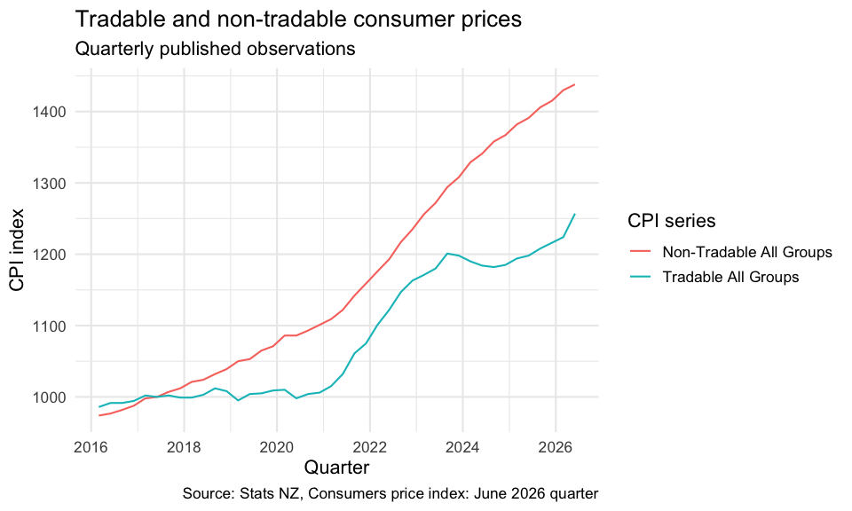

statsnzreleases
================

- [How this relates to Aotearoa Data
  Explorer](#how-this-relates-to-aotearoa-data-explorer)
- [Installation](#installation)
- [First success: inspect the release catalogue
  offline](#first-success-inspect-the-release-catalogue-offline)
- [Retrieve and chart a time series](#retrieve-and-chart-a-time-series)
- [Supported release families](#supported-release-families)
- [Import a release](#import-a-release)
- [Output contract](#output-contract)
- [Common workflows](#common-workflows)
- [Reproducible reads: network, cache, and
  credentials](#reproducible-reads-network-cache-and-credentials)
- [Scope and troubleshooting](#scope-and-troubleshooting)
- [Citation, licensing, and source
  data](#citation-licensing-and-source-data)
- [Contributing and support](#contributing-and-support)

<!-- README.Rmd is the source of README.md. Regenerate README.md after editing. -->

[](https://opensource.org/license/mit)

`statsnzreleases` gives R users a reproducible path from Stats NZ
economic release pages to analysis-ready time-series tibbles. It
discovers supported releases, selects documented CSV, ZIP, and XLSX
attachments, standardises series, period, and value fields, caches
attachments, and records exact attachment-level provenance.

Use it to:

- discover supported release families from the bundled registry or the
  official release calendar;
- inspect the files attached to an official release page;
- import supported release files into a common `statsnz_release_data`
  tibble;
- filter exact series and inclusive periods; and
- retain release URLs, cache paths, retrieval times, byte counts, and
  SHA-256 hashes for reproducible analysis.

The package focuses on economic release families that Stats NZ
distributes through information-release pages and attached data files.
It complements the Aotearoa Data Explorer API with documented adapters
for those workflows.

## How this relates to Aotearoa Data Explorer

Stats NZ is moving data from older dissemination tools into the
[Aotearoa Data Explorer](https://explore.data.stats.govt.nz/), while
many information releases still publish downloadable files. These access
paths can overlap, but they have different contracts.

`statsnzreleases` uses the release-file path:

1.  `statsnz_releases()` reads the package’s offline registry.
2.  `statsnz_latest_release()` optionally calls the public,
    credential-free Stats NZ website endpoint
    `https://www.stats.govt.nz/api/v1/releaseCalendarMonth/YYYY-MM` to
    find a matching information-release page.
3.  `statsnz_release_files()` and `read_statsnz_release()` read that
    page, select its documented CSV, ZIP, or XLSX attachments, download
    them directly from Stats NZ, and record attachment-level cache and
    hash provenance.

The package does **not** query the Data Explorer catalogue or data
endpoints, does not accept an API subscription key, and does not
translate package `release_id` values into Data Explorer dataset
identifiers. Stats NZ’s [API
guide](https://portal.apis.stats.govt.nz/api-guide) and [API
Portal](https://portal.apis.stats.govt.nz/) describe that separate
access route; API use requires registration, a subscription, and a
subscription key.

| Need | Use |
|----|----|
| An exact published release attachment, its release-page context, a supported family-specific parser, and reproducible file hashes | `statsnzreleases` |
| A custom table or dimensional query from a dataset available in Data Explorer | Aotearoa Data Explorer or its API |

This boundary is deliberate. Silently switching an import from a
published file to a Data Explorer query could change the schema,
revision state, and provenance of the result. If Stats NZ moves a
supported family to a Data-Explorer-only workflow, the package adapter
must be updated explicitly; until then, the reader reports its existing
typed page or attachment error.

## Installation

Install the development version from GitHub:

``` r
install.packages("remotes")
remotes::install_github("chartwell-macro/statsnzreleases")
```

Then load the package:

``` r
library(statsnzreleases)
```

`statsnzreleases` is available from GitHub while its CRAN release is
being prepared. GitHub is the supported installation path for the
current source; install from CRAN once the package has been accepted
there.

## First success: inspect the release catalogue offline

The release catalogue is bundled with the package, so this first step
does not make a network request. It is useful for discovering the
supported IDs before choosing a release to import.

``` r
library(statsnzreleases)

catalogue <- statsnz_releases(include_unsupported = FALSE)
knitr::kable(
  catalogue[, c("release_id", "release_name", "frequency", "supported")]
)
```

| release_id | release_name | frequency | supported |
|:---|:---|:---|:---|
| nz_stats_cpi | Consumers Price Index | quarterly | TRUE |
| nz_stats_gdp | Gross Domestic Product | quarterly | TRUE |
| nz_stats_electronic_cards | Electronic Card Transactions | monthly | TRUE |
| nz_stats_retail | Retail Trade Survey | quarterly | TRUE |
| nz_stats_balance_payments | Balance of Payments and International Investment Position | quarterly | TRUE |
| nz_stats_labour | Labour Market Statistics | quarterly | TRUE |
| nz_stats_trade | Overseas Merchandise Trade | monthly | TRUE |

The returned columns are the package’s release-family metadata. Use the
exact `release_id` values from this table in the import functions below.
The bundled manifest is the source of truth for the release families and
matching rules supported by the installed version.

## Retrieve and chart a time series

This complete workflow discovers a fixed CPI release, retrieves two
official quarterly series, selects the package’s `period_date`,
`data_value`, and `series_label` columns, and draws a line chart. Run
these calls when network access is available:

``` r
latest_cpi <- statsnz_latest_release(
  "nz_stats_cpi",
  as_of = as.Date("2026-08-24"),
  lookback_months = 2L
)

cpi <- read_statsnz_release(
  "nz_stats_cpi",
  release_url = latest_cpi$url[[1L]],
  series = c("CPIQ.SE9NS6000", "CPIQ.SE9NS6500"),
  start_period = "2016.03",
  end_period = "2026.06",
  quiet = TRUE
)
```

The rendered chart is deterministic and offline: documentation builds
feed an installed, attributed row extract from [*Consumers price index:
June 2026
quarter*](https://www.stats.govt.nz/information-releases/consumers-price-index-june-2026-quarter/)
through the same public reader, attachment selector, parser,
standardiser, filters, class, and provenance path. Only the release-page
lookup and download transport are replaced during rendering. The
[Getting Started
guide](https://chartwell-macro.github.io/statsnzreleases/articles/getting-started.html)
explains that path. The extract includes Stats NZ data licensed by Stats
NZ for reuse under CC BY 4.0; the installed `extdata/README.md` snapshot
record documents the source attachment, hashes, extraction, and full
attribution.

The standard output is already long-form, so chart preparation only
needs row and column selection:

``` r
chart_data <- cpi[
  !is.na(cpi$period_date) & !is.na(cpi$data_value),
  c("period_date", "data_value", "series_label")
]
knitr::kable(utils::head(chart_data, 4L), digits = 1L)
```

| period_date | data_value | series_label        |
|:------------|-----------:|:--------------------|
| 2016-03-01  |      985.8 | Tradable All Groups |
| 2016-06-01  |      991.5 | Tradable All Groups |
| 2016-09-01  |      991.5 | Tradable All Groups |
| 2016-12-01  |      994.3 | Tradable All Groups |

``` r
if (requireNamespace("ggplot2", quietly = TRUE)) {
  ggplot2::ggplot(
    chart_data,
    ggplot2::aes(
      x = period_date, y = data_value,
      colour = series_label, group = series_label
    )
  ) +
    ggplot2::geom_line() +
    ggplot2::labs(
      title = "Tradable and non-tradable consumer prices",
      subtitle = "Quarterly published observations",
      x = "Quarter",
      y = "CPI index",
      colour = "CPI series",
      caption = "Source: Stats NZ, Consumers price index: June 2026 quarter"
    ) +
    ggplot2::theme_minimal(base_size = 13)
}
```



## Supported release families

The package reads the official attachment formats shown here. “Curated”
identifies the documented subset that an adapter imports from a larger
official release file.

| Release ID | Official source and frequency | What the adapter reads | Adapter scope |
|:---|:---|:---|:---|
| `nz_stats_cpi` | Consumers Price Index; quarterly CSV attachments | Four official CPI CSV families, combined with deterministic duplicate handling | First selected attachment wins for repeated series-period observations |
| `nz_stats_gdp` | Gross Domestic Product; quarterly CSV attachment | The primary historical CSV | Historical table workflow; the visualisation extract remains outside adapter scope |
| `nz_stats_electronic_cards` | Electronic Card Transactions; monthly ZIP attachment | The official ZIP’s CSV table | Validated release-page, ZIP-member, and schema rules |
| `nz_stats_retail` | Retail Trade Survey; quarterly ZIP attachment | The official ZIP’s CSV table | Validated release-page, ZIP-member, and schema rules |
| `nz_stats_balance_payments` | Balance of Payments and International Investment Position; quarterly CSV attachment | The primary historical CSV | Manifest-defined primary-file workflow |
| `nz_stats_labour` | Labour Market Statistics; quarterly ZIP attachment | The standard LMS table, streamed to retain curated HLFS, QES, and LCI headline series | Curated headline subset of the wider LMS archive |
| `nz_stats_trade` | Overseas Merchandise Trade; monthly release workbook | Curated monthly and quarterly headline/category tables, including actual, seasonally adjusted, trend, value, and quantity series | Curated headline and category tables from the wider workbook |

`statsnz_releases()` is the source of truth for the currently installed
catalogue. Check its `supported`, `frequency`, and `note` columns rather
than assuming that a release family or attachment rule will remain
unchanged.

## Import a release

By default, `read_statsnz_release()` searches the official release
calendar for the latest matching release, downloads the selected
official attachments, and returns a standardised tibble. The following
live examples are ready for interactive use; offline documentation
rendering uses the attributed CPI snapshot demonstrated above.

``` r
latest <- statsnz_latest_release("nz_stats_cpi")
latest

cpi <- read_statsnz_release(
  "nz_stats_cpi",
  start_period = "2020.03",
  quiet = FALSE
)
head(cpi)
```

For a reproducible historical read, supply the exact official
information-release URL. The URL below is an example of the package’s
supported GDP release route; the page is fetched only when this chunk is
run locally.

``` r
gdp_url <- paste0(
  "https://www.stats.govt.nz/information-releases/",
  "gross-domestic-product-march-2026-quarter/"
)

gdp <- read_statsnz_release(
  "nz_stats_gdp",
  release_url = gdp_url,
  start_period = "2020.03",
  quiet = TRUE
)

head(gdp)
```

Select exact series references from the imported table or from source
documentation before applying the reader’s `series` filter:

``` r
one_series <- unique(gdp$series_reference)[[1L]]

gdp_filtered <- read_statsnz_release(
  "nz_stats_gdp",
  release_url = gdp_url,
  series = one_series,
  start_period = "2020.03",
  end_period = "2025.12",
  quiet = TRUE
)
```

## Output contract

An import returns a tibble with class `statsnz_release_data` (in
addition to the usual tibble/data-frame classes) and a
`statsnz_provenance` attribute. The standard leading columns are:

| Column | Meaning |
|:---|:---|
| `release_id`, `release_name`, `tier`, `frequency` | Package release-family metadata |
| `series_reference` | Stats NZ series identifier |
| `series_label` | Human-readable label assembled from source description/title fields when available |
| `period` | Source period text, normally `YYYY` or `YYYY.MM` |
| `period_date` | Date representation: first day of the year or month |
| `data_value` | Numeric value where the source value can be parsed; missing/unsupported values remain `NA` |
| `data_value_raw` | Original source value text, including formatting such as thousands separators |
| `status`, `units`, `magnitude`, `subject`, `group` | Source metadata, retained as supplied or normalized by the adapter |
| `series_title_1`–`series_title_5`, `type`, `description`, `suppressed` | Optional source classification and label fields |
| `source_file`, `source_attachment_url` | Attachment-level origin for each observation |

Source-specific columns may follow the standard columns. Rows are
filtered by exact `series` values and inclusive period bounds when those
arguments are provided. Repeated `series_reference`/`period`
observations are de-duplicated according to the adapter’s attachment
order; the original attachment remains visible in the source columns.

## Common workflows

### Inspect attachments before importing

Use `statsnz_release_files()` to see the files exposed by an official
release page. This is useful when investigating an attachment mismatch
or checking what the source page currently publishes.

``` r
statsnz_release_files(gdp_url)
```

### Reproduce a historical read

Use an explicit official `release_url`, retain the series/period
arguments in your analysis code, and save the provenance returned for
the resulting object. The release URL is more reproducible than relying
on the moving “latest” result.

``` r
provenance <- statsnz_provenance(gdp)
provenance$release_url
provenance$retrieved_at
provenance$attachments
```

The attachment table includes each selected attachment’s URL, local
cache path, byte count, and SHA-256 hash.

### Reuse or refresh the cache

The default cache path is returned by `statsnz_cache_dir()`. Pass
`cache_dir` when a project needs an explicitly managed cache, and use
`refresh = TRUE` when you intentionally need to download the official
attachments again.

``` r
statsnz_cache_dir()

gdp_refreshed <- read_statsnz_release(
  "nz_stats_gdp",
  release_url = gdp_url,
  cache_dir = statsnz_cache_dir(),
  refresh = TRUE,
  quiet = TRUE
)
```

## Reproducible reads: network, cache, and credentials

- No Stats NZ credentials, API key, or login is required.
- Requests use HTTPS and are restricted to official `stats.govt.nz`
  URLs. An information-release URL must be under
  `https://www.stats.govt.nz/information-releases/`.
- Calendar and release-page metadata are fetched in memory. Attachments
  are downloaded to the package cache using temporary files before they
  are placed in the final cache path.
- The default cache uses R’s platform-specific user-cache location via
  `tools::R_user_dir()`. The package does not install-time download
  source data.
- `refresh = FALSE` reuses a non-empty cached attachment;
  `refresh = TRUE` downloads it again. `quiet` controls curl download
  progress only.
- Network-dependent examples and tests should be opt-in. The package’s
  live test suite is controlled by `STATSNZRELEASES_LIVE`; this variable
  is not needed for ordinary imports.

An ordinary import fetches and validates the release page even when its
selected attachments are already cached, so the public reader is not a
fully offline mode. For reproducible work, retain the cache and
provenance and use an explicit release URL whenever network access is
available. A cache is not a license to redistribute the source files:
Stats NZ describes its default copyright terms, including attribution
requirements and exclusions, in its [copyright
guidance](https://www.stats.govt.nz/about-us/copyright/). Check that
guidance and any terms attached to the relevant release before sharing
downloaded data.

## Scope and troubleshooting

The package provides documented adapters for the families listed by
`statsnz_releases()`. Each adapter validates the release page, selects
the configured attachments, and reports typed errors when the official
layout or schema changes rather than silently returning a different
table. The most useful recovery sequence is:

1.  Check the `release_id` with `statsnz_releases()`.
2.  For a historical read, verify that `release_url` is the matching
    official information-release page.
3.  Inspect current attachments with
    `statsnz_release_files(release_url)`.
4.  Retry with a writable `cache_dir` or `refresh = TRUE` if a cached
    file is incomplete or stale.
5.  Preserve the error class and message when reporting a changed source
    page.

| Error family | Typical cause | First check |
|:---|:---|:---|
| `statsnz_invalid_release`, `statsnz_unknown_release`, `statsnz_unsupported_release` | ID is malformed, unknown, or not supported in this version | `statsnz_releases()` |
| `statsnz_invalid_url` | URL is not an official HTTPS Stats NZ URL | Use the release page URL under the official information-release path |
| `statsnz_release_not_found` | No matching publication was found in the calendar lookback | Check `as_of`, `lookback_months`, and the live calendar |
| `statsnz_request_error`, `statsnz_http_error`, `statsnz_response_too_large` | Network, HTTP, or safety-limit failure | Retry later and inspect the URL/status; do not bypass URL validation |
| `statsnz_release_page_error`, `statsnz_attachments_not_found`, `statsnz_attachment_mismatch`, `statsnz_release_mismatch` | Page layout, title, or attachment names no longer match | Run `statsnz_release_files()` and confirm the release family |
| `statsnz_csv_error`, `statsnz_schema_error`, `statsnz_zip_error`, `statsnz_workbook_error`, `statsnz_attachment_type_error` | Source file is malformed or schema/format changed | Check the selected attachment and report the source URL |
| `statsnz_download_error`, `statsnz_cache_error` | Download or cache path is not writable/complete | Choose a writable `cache_dir`; use `refresh = TRUE` deliberately |
| `statsnz_invalid_date`, `statsnz_invalid_period`, `statsnz_invalid_argument` | Invalid date, period, or lookback argument | Use `YYYY`/`YYYY.MM`; ensure `start_period <= end_period` |

Labour and trade deserve particular care: labour output is a curated
headline subset of the LMS table, while trade output is a curated set of
workbook tables. Neither adapter promises a lossless import of every
source row.

## Citation, licensing, and source data

Package code is released under the MIT license, copyright Chartwell Macro. Stats
NZ source files retain their own copyright and attribution terms. Stats
NZ’s [copyright guidance](https://www.stats.govt.nz/about-us/copyright/)
describes CC BY 4.0 as the default for Stats NZ-produced content,
subject to the guidance’s exclusions and any more specific notice on an
individual release or attachment. Each imported object retains the
official release and attachment URLs so that users can cite the
underlying publication, apply the required attribution, and check its
current terms before redistribution.

Use `citation("statsnzreleases")` for the package citation:

> Chartwell Macro. *statsnzreleases: Import and Standardise Stats NZ Economic
> Release Files*. <https://github.com/chartwell-macro/statsnzreleases>

When publishing results, also record the release URL, retrieval date,
selected attachment URLs, and SHA-256 hashes from
`statsnz_provenance()`.

## Contributing and support

Bug reports and reproducible source-page failures can be sent to [chartwellmacro@gmail.com](mailto:chartwellmacro@gmail.com). Please
include the package version, R version/platform, release ID, release URL
(if applicable), error class/message, and the output of
`statsnz_provenance()` when a read has progressed far enough to produce
it.

Pull requests should preserve the public output contract, use official
source URLs, add deterministic fixture-backed tests for parser changes,
and keep live network checks opt-in. The package is maintained as a
small release-file importer; proposals for new release families should
include the source attachment rule, expected schema, limitations, and
fixture-backed tests.
